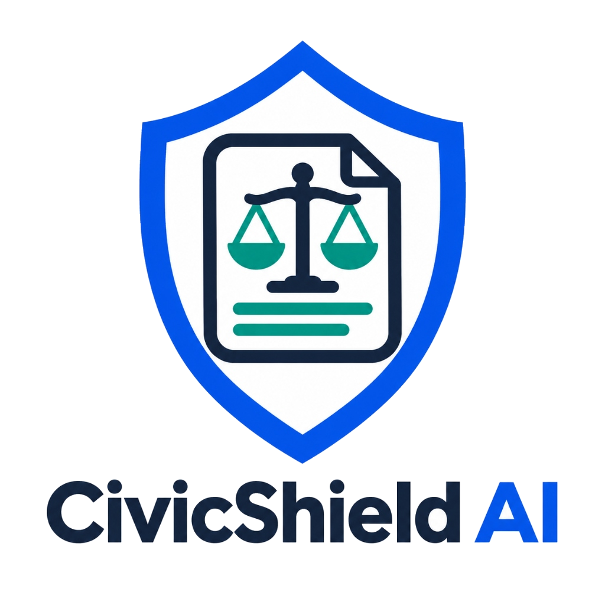

# CivicShield AI

### Intelligent Crime Reporting, Complaint Management & Citizen Assistance Platform

<p align="center">
  
</p>

CivicShield AI is an intelligent crime reporting, complaint workflow, and citizen assistance web application built with Python, Flask, and local Natural Language Processing. It bridges the gap between citizens, law enforcement personnel, and police administration by providing a modern, secure, and auditable digital complaint pipeline.

---

## Highlights & Capabilities

1. **AI-Assisted Category Suggestion**:
   - Analyzes citizen complaint narratives using scikit-learn TF-IDF vectorization and a calibrated Linear Support Vector Classifier.
   - Provides non-intrusive category recommendations with confidence scoring as citizens draft their statements.
   - Operates 100% locally on standard CPU hardware without external paid API dependencies.

2. **Bilingual Citizen Support**:
   - Dual-language interface and procedural guidance in English and Tamil (தமிழ்).
   - Interactive FAQ drawer assisting with report filing, required documents, and cyber complaint guidelines.

3. **Guided 4-Step Submission Wizard**:
   - Step 1: Incident narrative, occurrence date/time, and AI-suggested category.
   - Step 2: District, jurisdiction selection, and landmark identification.
   - Step 3: Quarantined evidence upload (JPG, PNG, PDF) with client previews.
   - Step 4: Summary review and legal declaration.

4. **Transparent Station Personnel Directory**:
   - Each police station displays a 5-officer directory with ranks, unique badge numbers, and availability.
   - Administrative account provisioning allows one-click credential generation linked to officer records.

5. **Milestone Tracking & Investigation Notes**:
   - Unique tracking numbers (e.g., `CS-2026-119952`).
   - Step-by-step milestone progression from intake to case resolution.
   - Chronological investigation logs recorded by assigned officers.

6. **Defensive Application Security**:
   - PBKDF2 password hashing with SHA-256 via Werkzeug.
   - Cryptographic CSRF protection across all forms and JSON API routes.
   - Server-side Role-Based Access Control (RBAC) isolating officer cases and administrative functions.
   - Quarantined file storage preventing public execution of uploaded assets.
   - CSV formula injection sanitization on data export endpoints.

---

## Screenshot Gallery

| Figure | View Name | File Reference |
| :---: | :--- | :--- |
| **01** | Public Landing Page | `docs/screenshots/fig1_landing_page.png` |
| **02** | Citizen Dashboard | `docs/screenshots/fig2_citizen_dashboard.png` |
| **03** | Smart Intake & AI Category Suggestion | `docs/screenshots/fig3_smart_complaint_submission.png` |
| **04** | Station-Based Officer Directory | `docs/screenshots/fig4_station_officer_directory.png` |
| **05** | Complaint Milestone Tracking Timeline | `docs/screenshots/fig5_complaint_tracking_timeline.png` |
| **06** | Administrator Command Center | `docs/screenshots/fig6_admin_dashboard.png` |
| **07** | Police Personnel Roster Management | `docs/screenshots/fig7_manage_officers.png` |
| **08** | Investigating Officer Case Review | `docs/screenshots/fig8_officer_dashboard.png` |
| **09** | Crime Analytics & Statistical Reports | `docs/screenshots/fig9_crime_analytics.png` |
| **10** | Bilingual Citizen Assistance Drawer | `docs/screenshots/fig10_bilingual_assistance.png` |
| **11** | Mobile Responsive Interface | `docs/screenshots/fig11_mobile_responsive.png` |

---

## Technical Stack

- **Core**: Python 3.10+, Flask 3.0, Flask-SQLAlchemy 3.1, Flask-Login 0.6, Flask-WTF 1.2, Flask-Limiter 3.8
- **Machine Learning**: Scikit-Learn 1.4+ (TF-IDF Vectorization, LinearSVC, CalibratedClassifierCV)
- **UI & Layout**: Bootstrap 5.3.2, FontAwesome 6.5.1, Chart.js 4.4.1, Vanilla ES6 JavaScript
- **Reporting & Export**: ReportLab 4.1 (cryptographic PDF dockets), Python CSV with formula escaping
- **Testing**: Pytest 8.2 (17 automated tests)

---

## Local Setup & Quickstart

### 1. Clone & Environment Setup

```bash
git clone https://github.com/Praburam617/CivicShield-AI.git
cd CivicShield-AI
python -m venv civicenv
```

Activate the environment:
- **Windows (PowerShell)**: `.\civicenv\Scripts\Activate.ps1`
- **Linux / macOS**: `source civicenv/bin/activate`

Install dependencies:
```bash
pip install -r requirements.txt
```

### 2. Database Initialization & Demo Accounts

```bash
cp .env.example .env
python reset_database.py --confirm
```

This seeds 14 police stations, 14 crime categories, 70 officer profiles, and the demonstration personas:
- **Administrator**: `praburam` / `Praburam@123`
- **Police Officer**: `arun` / `Arun@123`
- **Citizen**: `surya` / `surya@123`

### 3. Launch Application

```bash
python run.py
```
Open [http://127.0.0.1:5000](http://127.0.0.1:5000) in your browser.

---

## Automated Test Execution

Execute the full test suite with:

```bash
python -m pytest -v
```

All 17 automated tests covering NLP classification, bilingual assistance, RBAC, officer assignments, and CSV/evidence security pass with 100% compliance.

---

## Developer

**Praburam S**  
*AI & Cyber Security Developer*  
GitHub: [praburam617](https://github.com/praburam617)

---

## Scope & Educational Disclaimer

CivicShield AI is an engineering portfolio project and academic prototype created to demonstrate secure full-stack development and local machine learning integration. It is not an authorized law enforcement system. In real-world emergency situations, citizens should contact official emergency helplines such as 112 or 100.\n