<div align="center">

  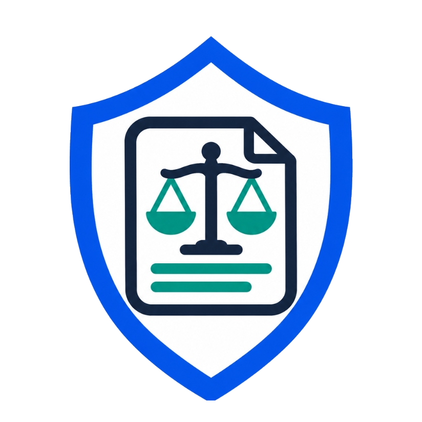

  # CivicShield AI

  ### AI-Powered Crime Reporting, Complaint Management & Citizen Assistance Platform

  <p align="center">
    <a href="https://www.python.org/"></a>
    <a href="https://flask.palletsprojects.com/"></a>
    <a href="https://scikit-learn.org/"></a>
    <a href="https://scikit-learn.org/"></a>
  </p>
  <p align="center">
    <a href="https://www.sqlite.org/"></a>
    <a href="SECURITY.md"></a>
    <a href="tests/"></a>
    <a href="LICENSE"></a>
  </p>

</div>

---

## 🛡️ Project Overview

**CivicShield AI** is an intelligent, full-stack crime reporting, grievance management, and citizen assistance web application engineered with Python, Flask, and local machine learning. The platform bridges the communication gap between citizens, law enforcement personnel, and police administrators by delivering a structured, transparent, and auditable digital complaint workflow.

Public intake systems often suffer from significant hurdles: citizens struggle with complex legal categories, police station jurisdictions remain ambiguous, manual paper-based logging delays investigations, and tracking ongoing case updates lacks transparency. CivicShield AI addresses these challenges through an integrated web system that automates crime category recommendations, maintains verified police station personnel directories, and enforces strict server-side Role-Based Access Control (RBAC).

Built with a CPU-friendly architecture, CivicShield AI executes natural language processing locally without mandatory third-party commercial cloud APIs.

> [!NOTE]
> **Educational & Demonstration Notice**: CivicShield AI is an independent academic and engineering portfolio demonstration developed by **Praburam S**. It is not an officially authorized law enforcement dispatch or emergency response system. In real-world emergencies, citizens must immediately dial official police helplines (**112** or **100**).

---

## 🌟 Key Features

### 1. AI-Powered Complaint Classification
- **N-Gram TF-IDF Vectorization**: Transforms citizen narrative statements into structured sublinear TF-IDF word vectors.
- **Calibrated Linear Support Vector Classifier**: Employs a trained scikit-learn `LinearSVC` model calibrated with `CalibratedClassifierCV` across 14 distinct criminal categories.
- **Real-Time Interactive Prediction**: Debounces citizen keystrokes in the complaint narrative textarea to suggest the most appropriate crime category alongside a statistical match confidence percentage.
- **Citizen Discretion & Fallbacks**: Citizens retain full autonomy to confirm or adjust the suggested category. Deterministic keyword heuristics provide reliable fallbacks for short descriptions.

### 2. Bilingual English and Tamil Citizen Assistance
- **Dual-Language Interface**: Complete bilingual support in English and Tamil (தமிழ்) across citizen help guides and FAQs.
- **Interactive Assistant Drawer**: Slide-out help drawer offering instant guidance on reporting protocols, required supporting documentation, and cyber grievance procedures.
- **Contextual Suggested Questions**: Pre-configured quick inquiry chips allowing one-click retrieval of structured guidance in either language.

### 3. Four-Step Guided Complaint Submission
- **Step 1 — Incident Information**: Collects incident title, detailed narrative, date/time, and AI-suggested category.
- **Step 2 — Jurisdictional Routing**: Guides district selection, relevant police station choice, landmark details, and presents the station's personnel directory.
- **Step 3 — Evidence Quarantining**: Drag-and-drop multi-file upload zone for images (JPG, PNG, WEBP) and PDF documents with client-side thumbnail previews.
- **Step 4 — Review & Declaration**: Form summary review with a mandatory legal declaration confirming statement truthfulness before submission.

### 4. Station-Based Officer Directory
- **Verified Station Rosters**: Each of the 14 registered police stations features an official roster of 5 fictional police officers across specialized wings (Law & Order, Crime Investigation, Cyber Forensics, General Patrolling, Women & Child Safety).
- **Public Jurisdictional Transparency**: Displays officer names, designations, unique badge numbers, and availability statuses during complaint filing.
- **Account Provisioning**: Administrators can provision secure login credentials linked directly to officer records with one click.

### 5. Manual Officer Assignment and Management
- **Administrative Assignment**: Administrators review incoming complaints and formally assign investigating officers based on jurisdictional station matching.
- **Jurisdiction Enforcement**: Server-side validation guarantees that only officers stationed at the assigned police station can be designated to investigate the case.
- **Workload Tracking**: Live tracking of active case counts per officer to maintain balanced case distribution across departments.

### 6. Complaint Tracking and Investigation Timeline
- **Unique Docket Identifiers**: Automatically generates alphanumeric reference codes (e.g., `CS-2026-119952`) upon submission.
- **Visual Milestone Progress**: Tracks complaint lifecycle through six defined milestones: *Submitted*, *Jurisdiction Assigned*, *Investigating Officer Assigned*, *Evidence Collected*, *Action Required*, and *Resolved*.
- **Investigation Case Notes**: Chronological case update log recorded by assigned officers and visible to citizens in real time.

### 7. Citizen, Administrator and Officer Dashboards
- **Citizen Dashboard**: Personal command center showing active dockets, investigation stages, recent notifications, and quick filing shortcuts.
- **Police Officer Dashboard**: Strict jurisdictional view of assigned dockets, evidentiary inspection, investigation note additions, and status update management.
- **Administrator Dashboard**: High-level executive overview featuring KPI metrics, station distributions, recent submissions, and system health status.

### 8. Crime Analytics and Advanced Search
- **Category Distribution Charts**: Interactive Chart.js visual breakdowns illustrating crime patterns across jurisdictions.
- **Monthly Filing Trends**: Historical volume tracking to monitor case registration frequency and resolution velocity.
- **Filtering & Search**: Dynamic filtering by complaint status, crime category, police station, and keyword search across incident summaries.

### 9. CSV and PDF Reporting
- **Formal PDF Dockets**: Generates formal First Information Dockets using ReportLab, complete with reference barcodes, incident summaries, and officer sign-off sections.
- **Sanitized CSV Data Export**: Administrative data export protected against CSV Formula Injection by prepending apostrophes to sensitive formula trigger characters (`=`, `+`, `-`, `@`).

### 10. Security, Privacy and In-App Notifications
- **Defensive Cryptography**: Salted password hashing via Werkzeug PBKDF2-SHA256. Plaintext passwords are never stored.
- **Isolated Evidence Storage**: Evidence files are quarantined outside the public static directory, verified via MIME-type checks, and served only through authenticated streaming routes.
- **CSRF & Rate Limiting**: Cryptographic CSRF validation across all forms and JSON APIs; Flask-Limiter brute-force request throttling.
- **In-App Notification Center**: Real-time unread counter and notification alerts notifying citizens and officers of case milestones and assignments.

---

## 🏗️ System Architecture

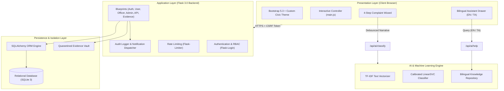

---

## 📸 System Screenshots

### Public Landing Page
<p align="center">
  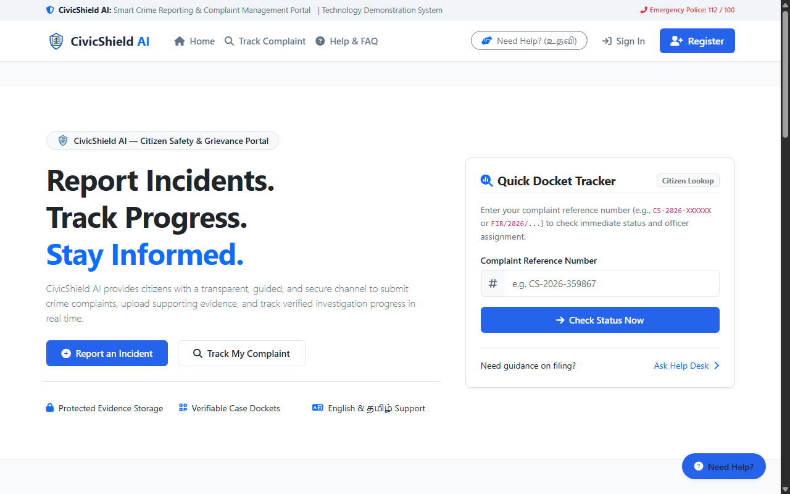
</p>
<p align="center">
  <em>Figure 1: Clean public landing portal featuring CivicShield AI branding, rapid intake navigation, and direct emergency police contact helplines.</em>
</p>

<br>

### Citizen Dashboard
<p align="center">
  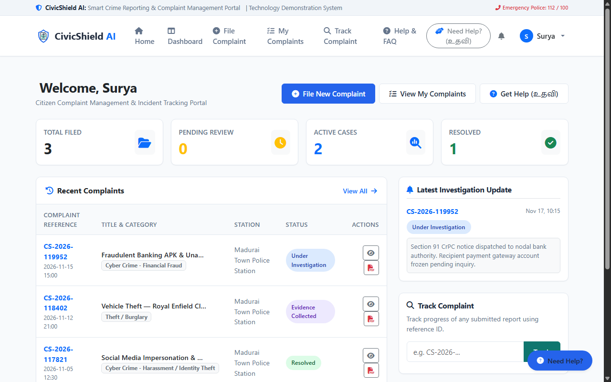
</p>
<p align="center">
  <em>Figure 2: Authenticated citizen dashboard showing registered complaint dockets, active investigation stages, and quick action controls.</em>
</p>

<br>

### AI-Assisted Complaint Submission
<p align="center">
  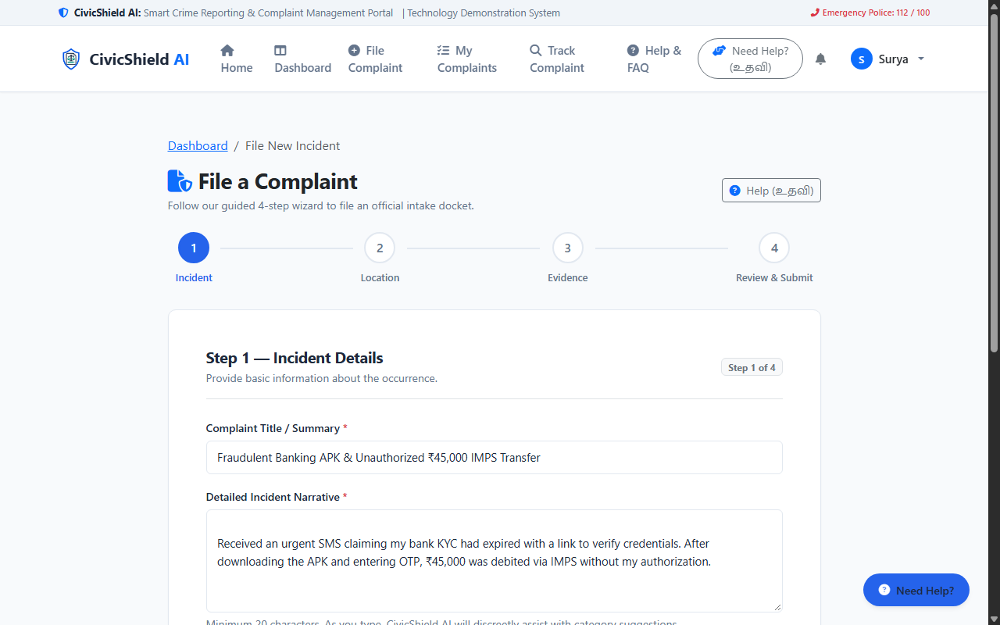
</p>
<p align="center">
  <em>Figure 3: Guided 4-step complaint intake wizard featuring real-time TF-IDF machine learning crime category suggestions with confidence scores.</em>
</p>

<br>

### Station-Based Officer Directory
<p align="center">
  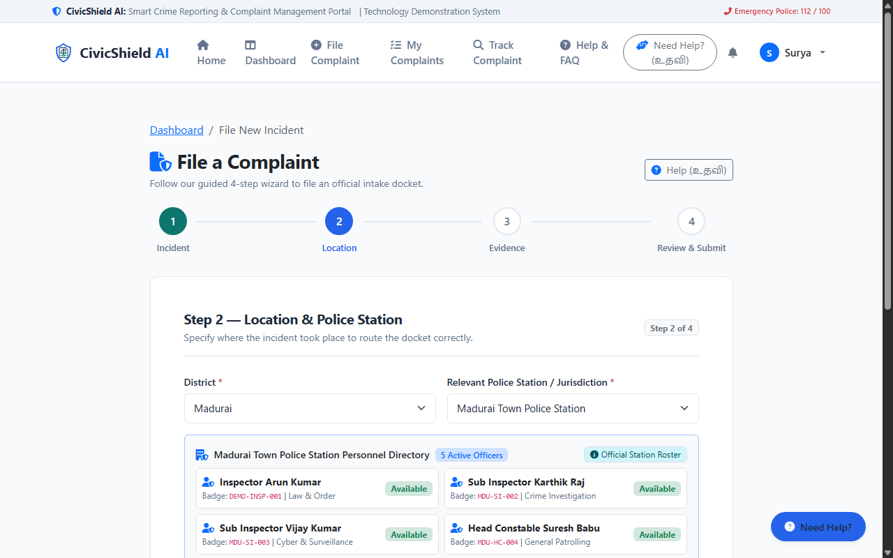
</p>
<p align="center">
  <em>Figure 4: Jurisdictional station selection interface displaying the verified 5-officer personnel directory for Madurai Town Police Station.</em>
</p>

<br>

### Complaint Tracking Timeline
<p align="center">
  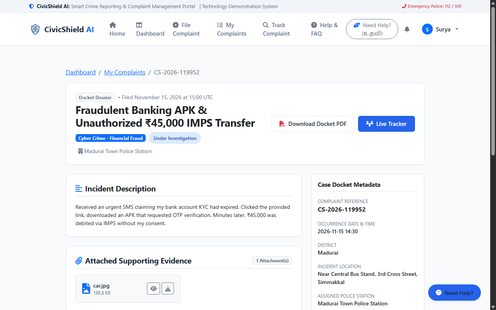
</p>
<p align="center">
  <em>Figure 5: Transparent milestone progress tracker illustrating chronological investigation updates, assigned investigating officer, and formal case notes.</em>
</p>

<br>

### Administrator Dashboard
<p align="center">
  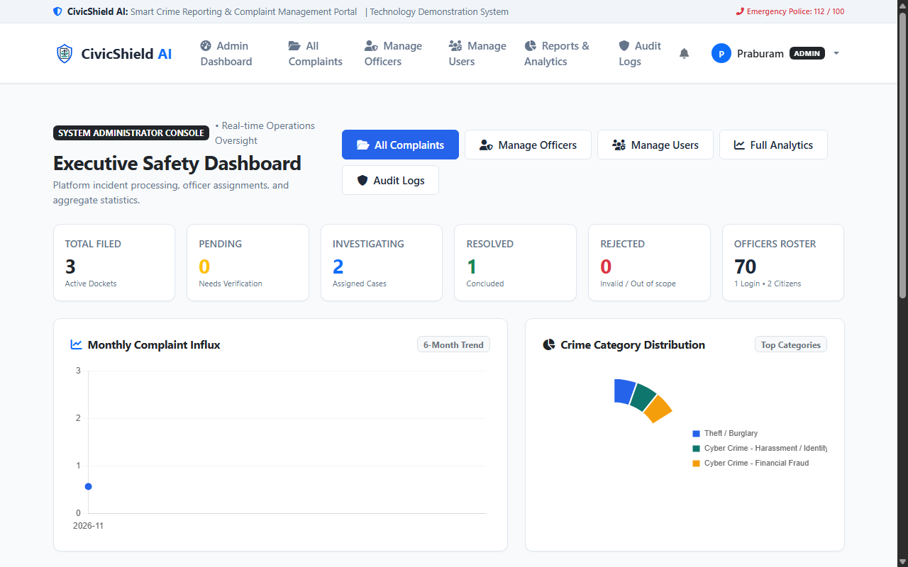
</p>
<p align="center">
  <em>Figure 6: Executive command center displaying real-time platform KPIs, category breakdowns, station statistics, and recent case submissions.</em>
</p>

<br>

### Police Officer Management
<p align="center">
  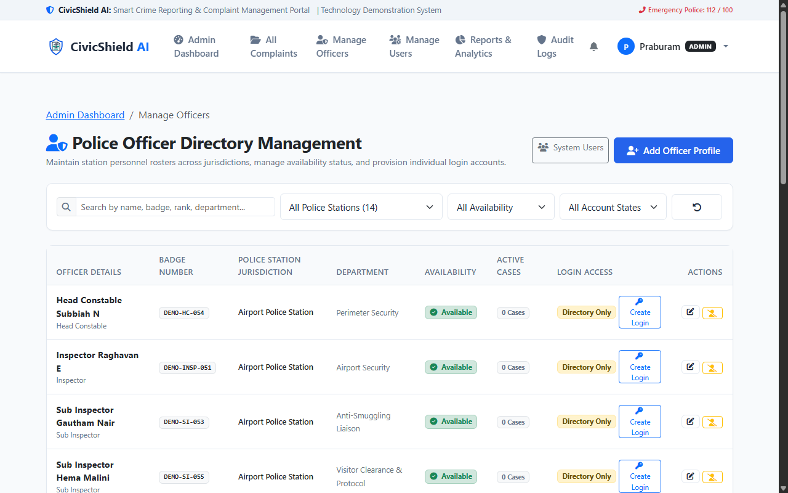
</p>
<p align="center">
  <em>Figure 7: Administrative police officer management directory displaying 70 personnel across 14 stations with badge numbers and account provisioning.</em>
</p>

<br>

### Police Officer Investigation Dashboard
<p align="center">
  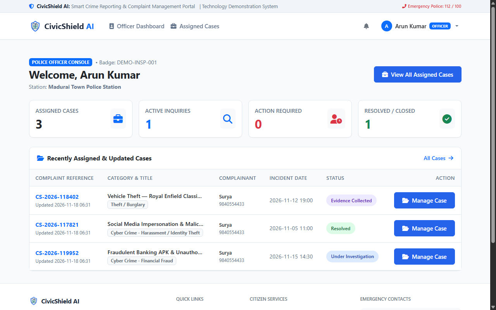
</p>
<p align="center">
  <em>Figure 8: Dedicated police officer investigation portal for reviewing assigned dockets, inspecting evidence, and logging chronological case updates.</em>
</p>

<br>

### Crime Analytics and Reports
<p align="center">
  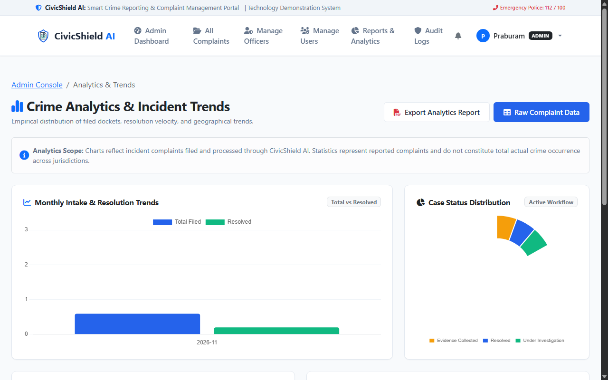
</p>
<p align="center">
  <em>Figure 9: Statistical analytics dashboard featuring category frequency charts, monthly complaint trends, and one-click CSV/PDF export capabilities.</em>
</p>

<br>

### Bilingual Citizen Assistance
<p align="center">
  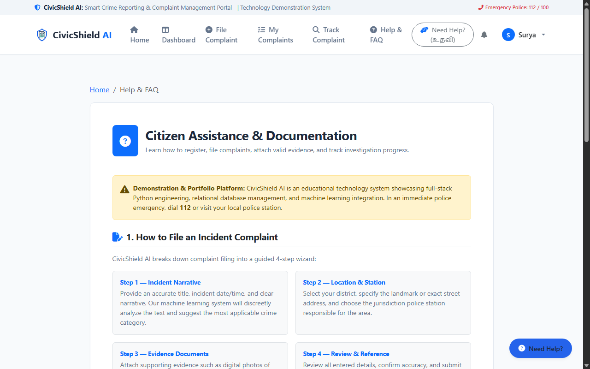
</p>
<p align="center">
  <em>Figure 10: Bilingual citizen knowledge assistant drawer providing structured legal guidance and reporting FAQs in English and Tamil (தமிழ்).</em>
</p>

<br>

### Mobile Responsive Interface
<p align="center">
  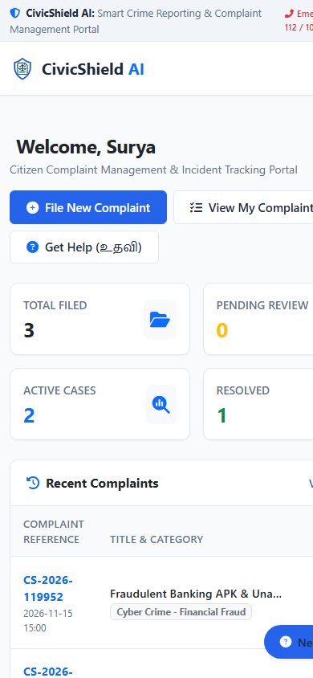
</p>
<p align="center">
  <em>Figure 11: Fully responsive smartphone layout illustrating mobile-friendly navigation, rapid touch interactions, and responsive card layouts.</em>
</p>

---

## ⚙️ Technology Stack

| Layer | Technology | Description |
|---|---|---|
| **Backend Framework** | Python 3.11, Flask 3.0 | Modular Python WSGI web application, blueprints, and routing |
| **Machine Learning** | scikit-learn 1.4+ | Incident narrative classification, category predictions, and confidence scoring |
| **Natural Language Processing** | TF-IDF, Calibrated Linear SVC | N-gram sublinear word frequency vectorization and text categorization |
| **Database** | SQLite 3 | Relational transactional complaint, officer, and user data storage |
| **Database ORM** | SQLAlchemy, Flask-SQLAlchemy 3.1 | Declarative models, schema migrations, and relational abstractions |
| **Authentication** | Flask-Login 0.6 | Session-based authentication and role-based access management |
| **Security** | PBKDF2-SHA256, Flask-WTF CSRF, RBAC | Salted password hashing, cryptographic form validation, and route isolation |
| **Rate Limiting** | Flask-Limiter 3.8 | Brute-force protection and IP-based request throttling |
| **Data Analytics** | Chart.js 4.4.1 | Interactive visual charts for crime categories and monthly trends |
| **Reporting** | ReportLab 4.1, Python CSV | Server-side cryptographic PDF docket generation and formula-sanitized CSV exports |
| **Frontend UI** | HTML5, CSS3, Bootstrap 5.3.2, JavaScript (ES6), Jinja2 | Responsive citizen-service design system, wizard controller, and templates |
| **Testing** | pytest 8.2 | Automated unit, integration, and security verification test suite |

---

## 🚀 Local Installation & Quickstart

### Prerequisites
- **Python 3.11** or newer
- **Git**

### 1. Clone the Repository
```bash
git clone https://github.com/Praburam617/CivicShield-AI.git
cd CivicShield-AI
```

### 2. Create and Activate Virtual Environment
**On Windows (PowerShell):**
```powershell
python -m venv civicenv
.\civicenv\Scripts\Activate.ps1
```

**On Linux / macOS:**
```bash
python3 -m venv civicenv
source civicenv/bin/activate
```

### 3. Install Dependencies
```bash
pip install --upgrade pip
pip install -r requirements.txt
```

### 4. Configure Environment
```bash
cp .env.example .env
```
*(On Windows PowerShell: `Copy-Item .env.example .env`)*

### 5. Safe Database Initialization
Initialize the database schemas, seed the 14 police stations, 14 crime categories, 70 officer profiles, and configure the local demonstration accounts:
```bash
python reset_database.py --confirm
```

### 6. Run the Application Server
```bash
python run.py
```
The application server will initialize and begin serving on:
```text
http://127.0.0.1:5000
```

---

## 👤 Demonstration Account Setup

The database initialization utility configures three functional test personas for local evaluation:

| Role | Username | Password | Linked Officer Profile / Jurisdiction | Purpose |
|---|---|---|---|---|
| **System Administrator** | `praburam` | `Praburam@123` | System Administrator | Full access to command center, officer roster management, user controls, and audit trails |
| **Police Officer** | `arun` | `Arun@123` | Inspector Arun Kumar (Badge: `DEMO-INSP-001`, Madurai Town PS) | Access to officer portal, assigned case review, evidence inspection, and investigation updates |
| **Citizen** | `surya` | `surya@123` | Citizen Account | Guided complaint wizard, personal docket tracking, and notification center |

> [!SECURITY]
> The demonstration credentials above are intended exclusively for local development and portfolio evaluation. In production environments, credentials must be generated securely via environment variables and updated through the administrative profile portal.

---

## 🧪 Running Automated Tests

CivicShield AI includes a comprehensive automated test suite covering natural language processing, bilingual assistance, user authentication, role-based boundaries, officer assignment validation, and defensive security controls.

```bash
python -m pytest -v
```

```text
============================= test session starts =============================
platform win32 -- Python 3.10.11, pytest-8.2.0, pluggy-1.7.0
rootdir: C:\Users\USER\OneDrive\Desktop\crime_reporting_system-main
configfile: pytest.ini
testpaths: tests
collected 17 items

tests/test_ai_services.py::test_ai_classifier_predictions PASSED         [  5%]
tests/test_ai_services.py::test_bilingual_assistant_en_and_ta PASSED     [ 11%]
tests/test_ai_services.py::test_api_ai_endpoints PASSED                  [ 17%]
tests/test_auth.py::test_register_citizen_success PASSED                 [ 23%]
tests/test_auth.py::test_login_and_role_redirect PASSED                  [ 29%]
tests/test_auth.py::test_login_invalid_credentials PASSED                [ 35%]
tests/test_complaints.py::test_submit_complaint_and_tracking PASSED      [ 41%]
tests/test_complaints.py::test_complaint_access_authorization PASSED     [ 47%]
tests/test_officer_admin.py::test_admin_and_officer_rbac PASSED          [ 52%]
tests/test_officer_admin.py::test_admin_assign_officer_and_officer_update PASSED [ 58%]
tests/test_officer_management_and_reset.py::test_station_officers_api PASSED [ 64%]
tests/test_officer_management_and_reset.py::test_station_based_assignment_validation PASSED [ 70%]
tests/test_officer_management_and_reset.py::test_cross_officer_isolation PASSED [ 76%]
tests/test_officer_management_and_reset.py::test_officer_directory_and_account_provisioning PASSED [ 82%]
tests/test_security_evidence.py::test_csv_formula_injection_defense PASSED [ 88%]
tests/test_security_evidence.py::test_evidence_file_content_validation PASSED [ 94%]
tests/test_security_evidence.py::test_pdf_generation_without_errors PASSED [100%]

============================= 17 passed in 8.49s ==============================
```

---

## 🌐 Live Demonstration & Deployment

CivicShield AI is designed to deploy seamlessly to standard WSGI hosting environments such as **PythonAnywhere**, **Render**, or **DigitalOcean**.

### Deploying to PythonAnywhere
1. Create an account at [PythonAnywhere](https://www.pythonanywhere.com/).
2. In the PythonAnywhere dashboard, open a **Bash Console** and clone this repository:
   ```bash
   git clone https://github.com/Praburam617/CivicShield-AI.git
   ```
3. Set up a Python 3.11 virtual environment and install dependencies:
   ```bash
   mkvirtualenv --python=/usr/bin/python3.11 civicenv
   pip install -r requirements.txt
   ```
4. Configure the **Web App** tab specifying **Manual Configuration (Flask)**.
5. In the WSGI configuration file (`/var/www/<username>_pythonanywhere_com_wsgi.py`), configure the application handler:
   ```python
   import sys
   import os

   path = '/home/<username>/CivicShield-AI'
   if path not in sys.path:
       sys.path.append(path)

   from app import create_app
   application = create_app()
   ```
6. Seed the production database in the console:
   ```bash
   python reset_database.py --confirm
   ```
7. Click **Reload Web App**.

*Live demonstration URL status: Available upon staging request.*

---

## ⚖️ Honest AI Disclosures & Limitations

CivicShield AI implements artificial intelligence responsibly, upholding transparency, human oversight, and data confidentiality:

- **Advisory Recommendations Only**: The machine learning classifier provides non-binding category suggestions. The system never autonomously rejects complaints, alters citizen testimony, or files formal charges without human verification.
- **Citizen Autonomy**: The citizen retains full control to confirm, override, or manually select incident categories prior to intake.
- **100% Local Processing**: All natural language processing executes locally on the server host. Citizen statements and personal narratives are never transmitted to external commercial AI APIs.
- **Confidence Calibration**: Predictions default to general categories when narratives are ambiguous, short, or lack legal keyword correlation.
- **Academic Scope**: This project is an educational engineering prototype. It does not replace authorized government emergency helplines.

---

## 🔮 Future Enhancements

- [ ] **Regional Dialect Voice Input**: Speech-to-text integration supporting voice-assisted complaint narration in colloquial Tamil dialects.
- [ ] **SMS & WhatsApp Dispatch Integration**: Automated SMS gateway webhooks delivering milestone alerts to citizens in rural zones.
- [ ] **GIS Crime Hotspot Mapping**: Heatmap visualization for administrative analysis of jurisdictional incident clusters.
- [ ] **Digital Signatures**: Cryptographic e-signing of formal First Information Dockets using national identity frameworks.
- [ ] **Offline PWA Capabilities**: Progressive Web App caching for offline draft preparation in low-connectivity rural areas.

---

## 👨‍💻 Developer

<div align="center">

**Praburam S**  
*AI & Cyber Security Developer*  

GitHub: [@Praburam617](https://github.com/Praburam617)  
Project Repository: [CivicShield-AI](https://github.com/Praburam617/CivicShield-AI)  

</div>

---

## 📄 License

This project is licensed under the **MIT License** — see the [LICENSE](LICENSE) file for complete details.

For security policies, defensive architectures, and vulnerability disclosure guidelines, please consult [SECURITY.md](SECURITY.md).

<div align="center">
<sub>Developed with passion for modern web engineering, defensive application security, and civic technology.</sub>
</div>
